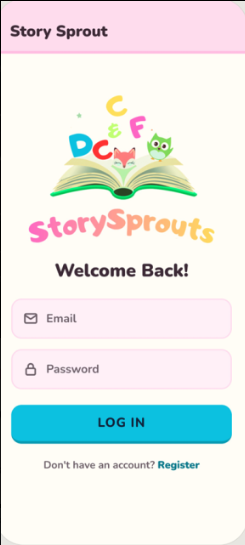
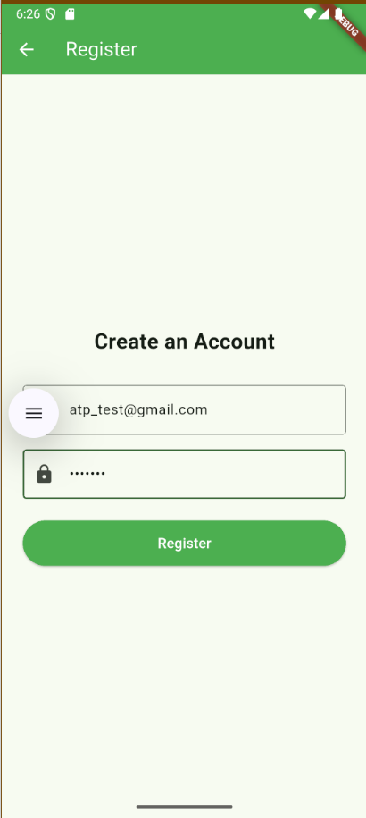
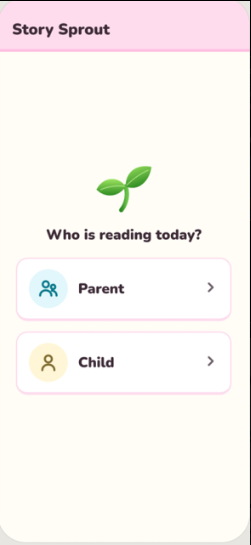
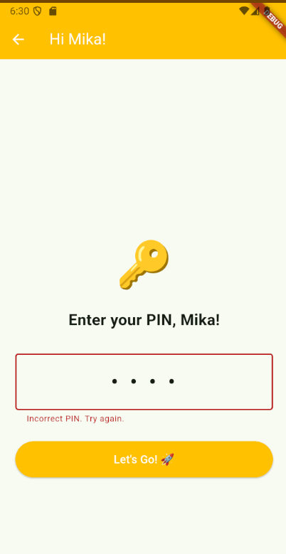
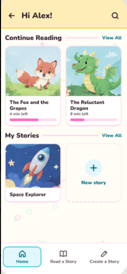
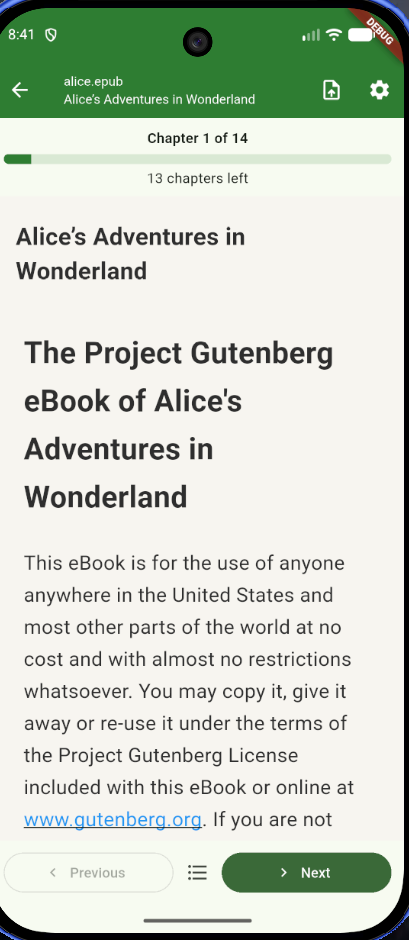
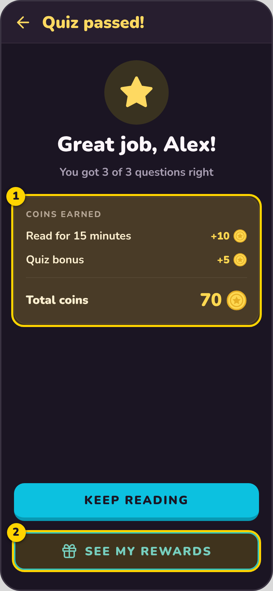
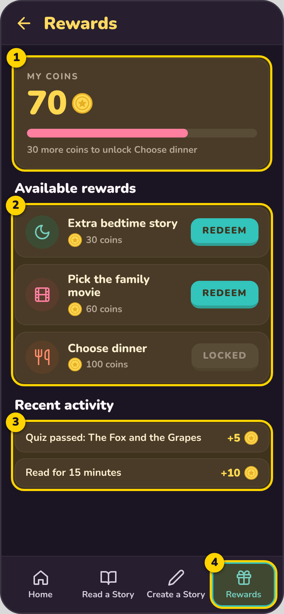
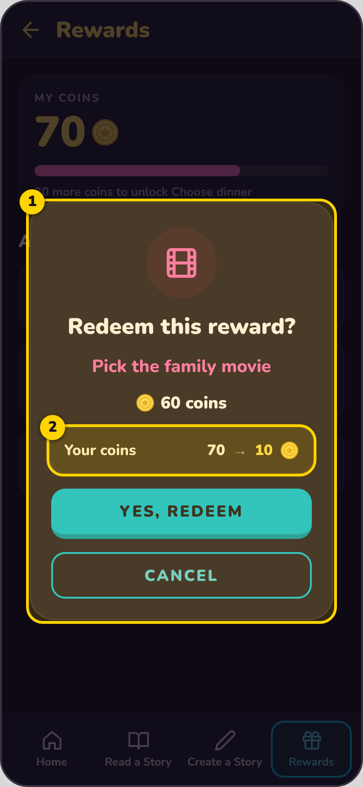
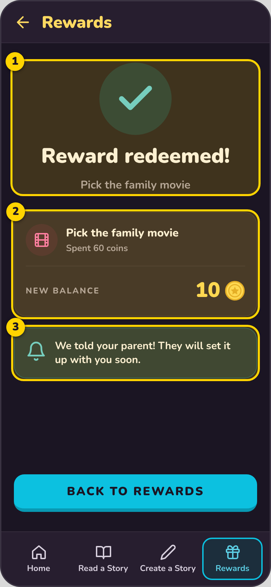

# Story Sprouts - User Manual

**Version:** 1.0
**Team Number:** Team #1
**Team Name:** Eagle Readers
**Team Members:** Oscar Balderas, Iada Bocoum, Quan Nguyen, Zac Riggle, Dustin Dowell
**Date:** 10/11/2026

---

## 1. Introduction

Story Sprout is an Android app that helps children build a reading habit while giving parents simple tools to guide them. Children import books, read them on a large, easy-to-read screen, and earn coins that they can trade for rewards their parents choose. Parents use a private dashboard to see what their child has read and how long they have spent reading, and to create rewards that keep reading fun.

---

## 2. System Requirements

- **Hardware:** An Android phone or tablet with at least 4 GB of RAM, about 200 MB of free storage, and an internet connection (needed to sign in and to save progress).
- **Operating System:** Android [version, e.g., 10 or newer].
- **Software:** No other software is needed to use the app. To import books, you need a book file in .txt or .epub format saved on your device.
- **Other Dependencies:** A parent email address and password to create an account.

---

## 3. Installation Guide

1. On your Android device, open [download link].
2. Tap **Download** (or **Install**).
3. If Android asks permission to install apps from outside the app store, tap **Settings** and allow it for this one install. *(Skip this step if you install from an app store.)*
4. When the download finishes, tap the file and then tap **Install**.
5. Tap **Open**. The Story Sprout welcome screen appears.

**For testers running it on a computer:** the project repository is at [https://github.com/nguyequa000/EagleReaders](https://github.com/nguyequa000/EagleReaders). Open it in Android Studio, start an Android emulator, and press **Run**.

---

## 4. Getting Started

1. **Open the app.** Tap the Story Sprout icon on your home screen.
2. **Create a parent account.** Tap **Register**, enter your email and a password, and submit.
3. **Add your first child.** Enter your child's name and choose a 4-digit PIN. Write the PIN down: your child needs it every time they open their profile.
4. **Land on the Parent Dashboard.** After the child is created, you are taken to the Parent Dashboard.
5. **Next time you open the app,** sign in with your email and password. You will then see a "Who is reading today?" screen where you choose **Parent** or **Child**.

---

## 5. Features & Functions

### Feature 1: Accounts, Child Profiles, and PINs

**What it does:** Keeps the parent area private and gives each child their own profile protected by a PIN.

**How to use it:**
1. Sign in with your parent email and password.
2. On "Who is reading today?", tap **Parent** and enter your PIN to open the Parent Dashboard.
3. To let a child read, tap **Child**, choose the child's name, and enter their 4-digit PIN. A wrong PIN is refused.
4. To leave, open **Parent Settings** and tap **Sign Out**.

### Feature 2: Reading Books

**What it does:** Lets a child import a book and read it in a large, clean, distraction-free view with no pop-ups while reading.

**How to use it:**
1. Sign in as a child and tap **Read a Story**.
2. Tap **Import** and choose a .txt or .epub file from your device.
3. Tap the book to open it. Tap **Next** and **Back** to turn pages.
4. Open **Reader Settings** to change the font size, line spacing, and theme (paper, white, or dark). Changes apply right away.
5. Close the book whenever you like. Story Sprout remembers your page and opens the book where you stopped.

### Feature 3: Parent Dashboard

**What it does:** Shows parents how much their child is reading.

**How to use it:**
1. Choose **Parent** on the "Who is reading today?" screen and enter your PIN.
2. On the dashboard, view **Books Read**, **Minutes Read This Week**, and **Stories Created**.
3. Tap **Child Profiles** to see a single child's recent activity, including which books they read and for how long.
4. Tap the **gear icon** at the top right for Parent Settings, such as the time limit and Sign Out.

### Feature 4: Coins and Rewards

**What it does:** Children earn coins for reading and spend them on rewards that their parents create. Coins are only for fun inside the app and have no real-money value.

**For parents – create a reward:**
1. Open the **Rewards** tab, then **Rewards Manager**.
2. Enter a title, a description, and a coin cost, then tap **Save**.
3. To change a reward, edit its cost. To remove it, retire (hide) it. Retired rewards no longer show to your child.

**For children – redeem a reward:**
1. Tap the **Rewards** tab to see your coin balance and the rewards your parent has set up.
2. Tap **Redeem** on a reward you can afford (rewards that cost too much show **Locked**).
3. Confirm the pop-up. Your new balance is shown, and the parent can see the redemption.

> **Coming soon:** AI-assisted story creation (building a hero, choosing a feeling and place), end-of-book quizzes with bonus coins, daily quests, badges, and word-pronunciation help are still being built and are not part of this version.

---

## 6. Troubleshooting

| Problem | Cause | Solution |
|---------|-------|----------|
| I can't sign in | Wrong email or password | Check your spelling and try again. A red message appears on the screen if the details are wrong. |
| Registration says my email is already used | An account already exists with that email | Go back and sign in instead, or register with a different email. |
| My child can't open their profile | Wrong 4-digit PIN | Enter the PIN again. If you have forgotten it, sign in as the parent and check the child's profile. |
| My book will not import | The file is empty or not .txt / .epub | Choose a different file. The app shows a friendly error and your other books still work. |
| The app does not log me out when idle | Automatic sign-out after inactivity is not yet working | Use **Parent Settings → Sign Out** when you finish. |
| I can't delete a reward | Rewards can currently be hidden but not deleted | Retire the reward so your child no longer sees it. |

---

## 7. Contact Information

- **Support Email:** Oscarbalderas2@gmail.com
- **Project Repository:** [https://github.com/nguyequa000/EagleReaders](https://github.com/nguyequa000/EagleReaders)

---

## 8. FAQ

**Q:** Do coins have real-world value?
**A:** No. Coins are only used inside Story Sprout to redeem rewards that parents create. They cannot be bought, sent to others, or turned into cash.

**Q:** Can more than one child use the app?
**A:** Yes. A parent can add child profiles, and each child has their own PIN, progress, and coins.

**Q:** Which books can my child read?
**A:** Books saved as .txt or .epub files. Reader settings make text larger or easier on the eyes.

**Pro-tip:** Pick a theme in Reader Settings that is comfortable for your child. The dark theme works well for bedtime reading.

**Pro-tip:** Set rewards with small coin costs at first so your child gets quick wins and stays motivated.
